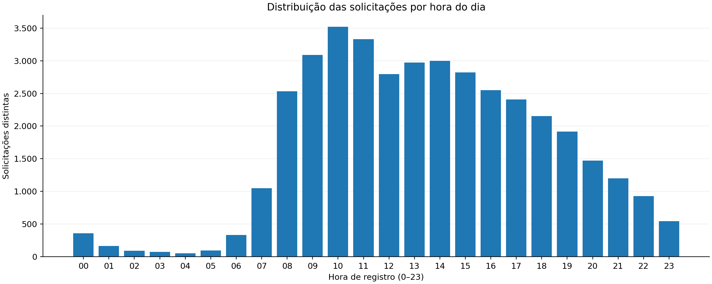
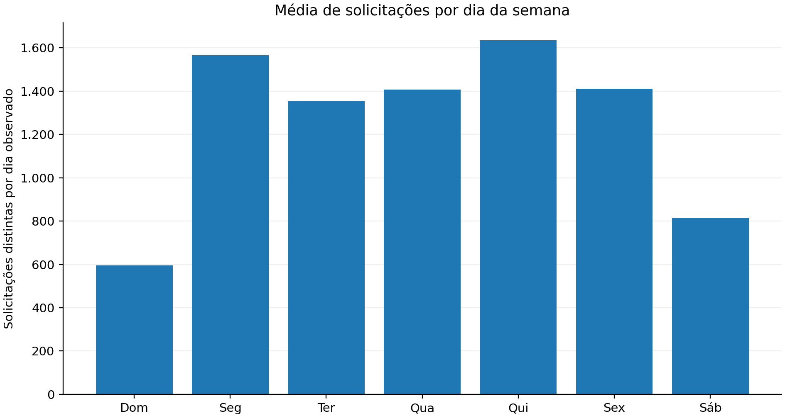

# Hello, City! — What the City's 156 Service Requests Reveal

**Project 03 · SQL / MySQL · Data Quality · Exploratory Data Analysis**  
**Version 0.1 — preliminary findings | Work in progress** · [Português](README.md)

> **Main question:** What do Curitiba's 156 municipal service records reveal about service demand patterns, and what data-quality precautions are needed to analyze them reliably?

| Records | Distinct requests | Variables | Observed period |
|---:|---:|---:|---|
| **41,490** | **39,451** | **21** | **Apr 1–May 1, 2024** |

**Navigation:** [The Problem](#1-the-problem) · [The Approach](#2-the-approach) · [The Results](#3-the-results) · [Project webpage](index.html)

---

## 1. The Problem

Curitiba's 156 municipal service channel logs requests, complaints, reports and other citizen inquiries. Studying these records may help identify **when** people submit requests and, in future stages, **which topics** and **locations** dominate. But the unit of analysis must first be understood: one request ID can appear in multiple rows.

This first release covers structural and quality checks, record granularity, and temporal patterns. Analyses by topic, municipal department and geographic area remain under development.

**Data source:** https://156.curitiba.pr.gov.br/Estatistica/Saiba-sobre-os-dados-de-atendimento-da-central-156

---

## 2. The Approach

### Tools used

| Tool | Role |
|---|---|
| **MySQL 8.0.44** | SQL querying and analysis |
| **DBeaver Community 26.2.4** | Running queries and verifying outputs |
| **Visual Studio Code** | Initial schema inspection |
| **SQL** | CTEs, grouping, duplicate investigations, time functions and checks |
| **Python / Matplotlib** | Static charts built from aggregated SQL exports |
| **GitHub / GitHub Pages** | Project documentation and presentation |

### Workflow

**Data exploration → quality audit → duplication analysis → date/time preparation → temporal SQL analysis → validation → visual storytelling.**

### Quality findings and decisions

| Check | Verified result | Analytical decision |
|---|---|---|
| Request granularity | 41,490 rows, 39,451 distinct request IDs | Count distinct requests when measuring demand |
| Repeated requests | 2,030 request IDs appear more than once | Inspect contents, not blindly delete duplicates |
| Response variations | 1,664 repeated requests have different `RESPOSTA_FINAL` values | Preserve response versions |
| Exact-content redundancy | 372 excess rows identical except for `id` | Avoid treating them as additional requests |
| Missing agency | 16,875 rows (40.67%) have no `ORGAO` | Do not automatically substitute `ORGAO_RESP` |
| Dates | All 41,490 values converted using `STR_TO_DATE` | Convert at query time |
| Times | All 41,490 values include trailing spaces; valid after `TRIM` | Clean text before `CAST(... AS TIME)` |
| Encoding | Some accented values show replacement characters | Investigate origin before renaming categories |

Among the 2,030 repeated request IDs, there were **no differences** in `TIPO`, `ASSUNTO`, `SUBDIVISAO`, `DATA`, `HORARIO`, `BAIRRO_ASS`, or `REGIONAL_ASS`.

### SQL example — count requests, not repeated records

```sql
SELECT
    COUNT(*) AS total_records,
    COUNT(DISTINCT SOLICITACAO) AS distinct_requests
FROM modulosql.chamados156;
```

### SQL example — hourly distribution

```sql
SELECT
    HOUR(CAST(TRIM(HORARIO) AS TIME)) AS hour_of_day,
    COUNT(DISTINCT SOLICITACAO) AS total_requests
FROM modulosql.chamados156
GROUP BY hour_of_day
ORDER BY hour_of_day;
```

The heatmap query uses **CTEs, JOIN and date/time functions** to divide hourly request counts by the number of occurrences of each weekday. [View heatmap SQL](sql/04_heatmap.sql) and the [execution guide](sql/README.md).

**Chart reproducibility:** the [aggregated heatmap CSV](data/heatmap_agregado.csv) contains no individual records. Install Python, NumPy and Matplotlib, then run `python scripts/gerar_graficos.py` to regenerate charts.

**Validation:** temporal outputs reconcile to **39,451 distinct requests**. Source records were left unchanged.

---

## 3. The Results

### Finding 01 — Requests peak during business hours



**10 a.m.** was the busiest hour with **3,520 distinct requests**. The 9–11:59 a.m. period accounted for **9,942 (25.2%)** requests, while 8 a.m.–5:59 p.m. accounted for **29,026 (73.6%)**.

### Finding 02 — Request volume varies by weekday



Thursday had the largest average (**1,634.25 requests per observed Thursday**); Sunday the smallest (**594.75**). Average daily weekday volume was approximately **2.09 times** weekend volume.

### Finding 03 — Weekday × hour heatmap


The highest hourly weekday average occurred on **Monday at 10 a.m. (147.2)**, followed closely by **Thursday at 11 a.m. (146.25)**. Heatmap values are normalized by the number of observed days.

### Finding 04 — Data quality affects analytical counts

**2,030** request IDs occur in more than one record, **372** excess rows are fully redundant apart from `id`, and **40.67%** of records lack `ORGAO`. The project explicitly differentiates request IDs from raw rows.

### Limitations and next steps

This dataset covers **Apr 1–May 1, 2024** only. Results are descriptive, not causal, and cannot establish yearly patterns or operating performance. Analysis of topics, municipal agencies, neighborhoods and bat-related reports is forthcoming.

---

[Project webpage](index.html) · [SQL scripts](sql/README.md) · [Data dictionary (PT)](docs/dicionario_dados.md) · [Technical notes (PT)](docs/registro_etapas.md)
