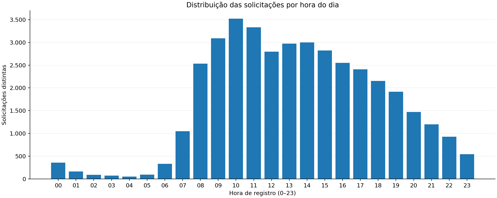
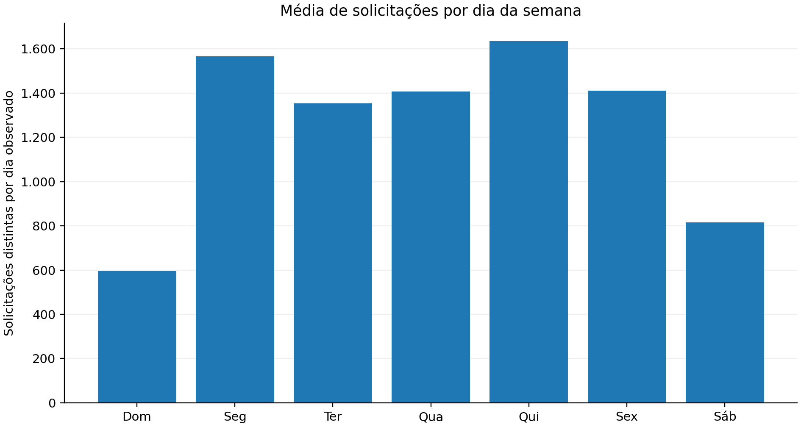
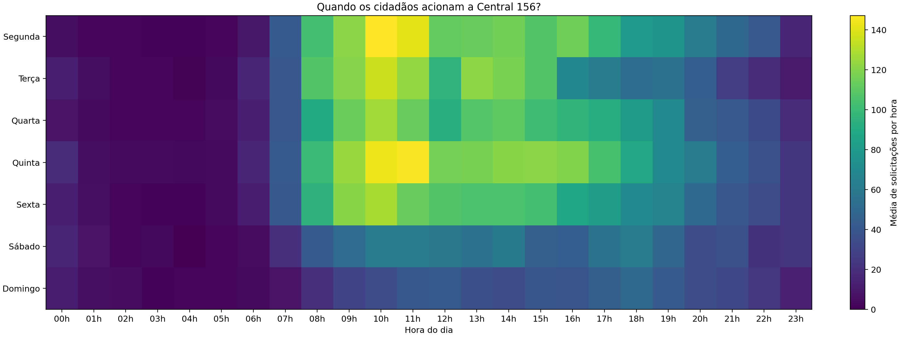

# Alô, Cidade! — O que os Chamados 156 Revelam

**Projeto 03 · SQL / MySQL · Qualidade de dados · Análise exploratória**  
**Versão 0.1 — resultados parciais | Em desenvolvimento** · [English version](README.en.md)

> **Pergunta central:** o que os registros da Central 156 de Curitiba revelam sobre os padrões de demanda municipal, e quais cuidados com a qualidade dos dados são necessários para uma análise confiável?

| Registros | Solicitações distintas | Variáveis | Recorte observado |
|---:|---:|---:|---|
| **41.490** | **39.451** | **21** | **01/04/2024 a 01/05/2024** |

**Navegação:** [O problema](#1-o-problema--the-problem) · [A solução e o processo](#2-a-solução-e-o-processo--the-approach) · [Resultados e visualização](#3-resultados-e-visualização--the-results) · [Página de apresentação](index.html)

---

## 1. O problema | THE PROBLEM

A Central 156 de Curitiba recebe e registra diferentes demandas relacionadas a serviços municipais. Esses dados podem ajudar a entender **quando** e **sobre quais temas** os cidadãos entram em contato, além de possíveis diferenças entre bairros e regionais.

Antes de construir indicadores, é necessário identificar a unidade de análise: **cada linha representa um registro**, mas uma solicitação pode aparecer em múltiplas linhas. Comparar volume de registros com volume de solicitações sem essa distinção pode distorcer conclusões.

**Objetivos desta etapa:** validar estrutura e qualidade dos dados, definir a contagem por solicitação e investigar a distribuição temporal dos atendimentos. As análises por assunto, órgão e território serão acrescentadas nas próximas versões.

**Fonte dos dados:** https://156.curitiba.pr.gov.br/Estatistica/Saiba-sobre-os-dados-de-atendimento-da-central-156

---

## 2. A solução e o processo | THE APPROACH

### Ferramentas utilizadas

| Ferramenta | Utilização |
|---|---|
| **MySQL 8.0.44** | Consulta e análise dos dados com SQL |
| **DBeaver Community 26.2.4** | Execução dos scripts e conferência de resultados |
| **Visual Studio Code** | Inspeção inicial da tabela e dos campos |
| **SQL** | CTEs, agregações, verificações de qualidade, funções de data/hora e comparação de conteúdos |
| **Python / Matplotlib** | Geração dos gráficos estáticos a partir do CSV **agregado** exportado das consultas SQL |
| **GitHub / GitHub Pages** | Documentação e apresentação do projeto |

### Fluxo de trabalho documentado

**Exploração da base → auditoria da qualidade → diagnóstico das duplicidades → validação e preparação de datas/horários → análise temporal com SQL → visualização → interpretação e limites.**

### Diagnóstico de qualidade: problema → evidência → decisão

| Verificação | Evidência confirmada | Decisão analítica |
|---|---|---|
| Granularidade | 41.490 registros; 39.451 solicitações distintas | Contar `SOLICITACAO` distinta para medir demanda |
| Repetições | 2.030 solicitações aparecem mais de uma vez | Investigar conteúdo antes de remover duplicatas |
| Diferenças entre versões | 1.664 solicitações repetidas têm `RESPOSTA_FINAL` diferente | Preservar versões de resposta para análises administrativas |
| Redundância integral | 372 registros excedentes idênticos em todas as colunas, exceto `id` | Não utilizá-los como solicitações adicionais |
| Órgão ausente | 16.875 registros sem `ORGAO` (40,67%) | Não imputar `ORGAO_RESP` automaticamente |
| Datas | 41.490 datas convertíveis com `STR_TO_DATE` | Converter em consulta, sem alterar a origem |
| Horários | 41.490 horários com espaços adicionais; 100% válidos após `TRIM` | Aplicar `TRIM` antes da conversão para `TIME` |
| Texto | Foram observados problemas de codificação em valores acentuados | Diagnosticar a origem antes de corrigir nomes e categorias |

A consistência de `TIPO`, `ASSUNTO`, `SUBDIVISAO`, `DATA`, `HORARIO`, `BAIRRO_ASS` e `REGIONAL_ASS` também foi testada nas 2.030 solicitações repetidas: **nenhuma divergência** foi encontrada nesses campos.

### Exemplo 1 — Contar solicitações sem superestimar a demanda

```sql
SELECT
    COUNT(*) AS total_registros,
    COUNT(DISTINCT SOLICITACAO) AS solicitacoes_distintas
FROM modulosql.chamados156;
```

**Resultado:** 41.490 registros e 39.451 solicitações distintas. A contagem por protocolo é a unidade usada nas análises temporais abaixo.

### Exemplo 2 — Auditar protocolos repetidos com função de janela

O uso de `ROW_NUMBER() OVER (PARTITION BY SOLICITACAO ORDER BY id)` identifica linhas adicionais sem presumir que são cópias integrais:

```sql
WITH protocolos AS (
    SELECT SOLICITACAO, id,
           ROW_NUMBER() OVER (
               PARTITION BY SOLICITACAO ORDER BY id
           ) AS rn,
           COUNT(*) OVER (
               PARTITION BY SOLICITACAO
           ) AS registros_no_protocolo
    FROM modulosql.chamados156
)
SELECT COUNT(*) AS registros,
       COUNT(DISTINCT SOLICITACAO) AS protocolos,
       COUNT(DISTINCT CASE WHEN registros_no_protocolo > 1
           THEN SOLICITACAO END) AS protocolos_repetidos,
       SUM(CASE WHEN rn > 1 THEN 1 ELSE 0 END) AS linhas_adicionais
FROM protocolos;
```

**Conciliação:** 2.023 protocolos com duas linhas, cinco com três e dois com quatro produzem **2.030 protocolos repetidos**, mas **2.039 linhas adicionais** (`2023 + 5×2 + 2×3`). Nem toda linha adicional é redundante. [Script SQL](sql/06_window_functions_auditoria.sql).

### Exemplo 3 — Preparar horários e analisar a demanda

```sql
SELECT
    HOUR(CAST(TRIM(HORARIO) AS TIME)) AS hora_do_dia,
    COUNT(DISTINCT SOLICITACAO) AS total_solicitacoes
FROM modulosql.chamados156
GROUP BY hora_do_dia
ORDER BY hora_do_dia;
```

**Decisão técnica:** `HORARIO` é armazenado como texto, com espaços adicionais; o `TRIM` evita resultados incorretos na conversão. A função `COUNT(DISTINCT ...)` impede contar uma solicitação repetida como demanda adicional.

### Exemplo 4 — CTEs, JOIN e normalização por dia observado

A consulta que produziu o mapa de calor usa duas CTEs e divide a quantidade de solicitações por hora pela quantidade de ocorrências daquele dia da semana. Isso evita comparar diretamente quatro quintas-feiras com cinco segundas-feiras.

**[Ver SQL completo do heatmap](sql/04_heatmap.sql)** · [Todos os scripts e ordem de execução](sql/README.md) · [Log técnico](docs/registro_etapas.md)

**Reprodução dos gráficos:** o [CSV agregado do heatmap](data/heatmap_agregado.csv) não contém registros individuais. Com Python, NumPy e Matplotlib instalados, execute `python scripts/gerar_graficos.py` para gerar novamente as imagens da pasta `assets/`.

**Validações:** as consultas temporais foram reconciliadas com o total de **39.451 solicitações distintas**. Os dados de origem permaneceram intactos.

---

## 3. Resultados e visualização | THE RESULTS

### Descoberta 01 — A demanda se concentra no horário comercial



A **hora de maior volume foi 10h**, com **3.520 solicitações** no período. Entre **09h e 11h59**, foram registradas **9.942 solicitações (25,2%)**; entre **08h e 17h59**, **29.026 (73,6%)**.

### Descoberta 02 — Há diferenças entre os dias da semana



| Dia da semana | Total de solicitações | Dias observados | Média por dia |
|---|---:|---:|---:|
| Domingo | 2.379 | 4 | 594,75 |
| Segunda-feira | 7.826 | 5 | 1.565,20 |
| Terça-feira | 6.768 | 5 | 1.353,60 |
| Quarta-feira | 7.036 | 5 | 1.407,20 |
| Quinta-feira | 6.537 | 4 | **1.634,25** |
| Sexta-feira | 5.645 | 4 | 1.411,25 |
| Sábado | 3.260 | 4 | 815,00 |

A maior média diária ocorreu **às quintas-feiras (1.634,25)** e a menor **aos domingos (594,75)**. Considerando a frequência de dias úteis e fins de semana na amostra, a média diária dos dias úteis foi aproximadamente **2,09 vezes** a dos fins de semana.

### Descoberta 03 — O mapa de calor revela janelas de maior concentração



O maior pico médio foi **segunda-feira, às 10h (147,2 solicitações por segunda-feira observada)**. A **quinta-feira às 11h (146,25)** apresentou valor muito próximo. O mapa utiliza a média por dia observado, e não os totais brutos.

### Descoberta 04 — Qualidade dos dados influencia os indicadores

A auditoria identificou **2.030 solicitações com múltiplos registros**, **372 registros integralmente redundantes (exceto `id`)** e **40,67% das linhas com `ORGAO` não preenchido**. Esses achados motivaram a decisão de separar **registros** de **solicitações distintas**, sem presumir que toda repetição fosse um erro.

### Descoberta 05 — Morcegos: onde e em quais horários os chamados foram registrados?

A consulta `SUBDIVISAO = 'Morcegos'` encontrou **97 registros e 95 solicitações distintas**, em **47 bairros**. Destas, **46 (48,4%)** pertencem à **Regional Matriz**, contra uma participação da Matriz de **20,9%** no total de protocolos da Central 156. Esse contraste indica concentração relativa dos registros, não maior presença comprovada de animais ou doenças.

| Bairro | Solicitações |
|---|---:|
| Centro | 14 |
| Batel | 9 |
| Cajuru | 6 |
| Cristo Rei | 5 |

**Horários registrados:** 06h–11h59 (39), 12h–17h59 (27), 18h–23h59 (26) e 00h–05h59 (3). O maior volume em uma hora foi às **09h (11 solicitações)**. Esses são horários de registro de solicitações, **não necessariamente de avistamento do animal**.

**Possível encaminhamento a ser avaliado:** analisar o alcance de orientações preventivas e o monitoramento de relatos nas áreas com mais registros, acompanhando dados de períodos adicionais e informações da vigilância. A [Unidade de Vigilância de Zoonoses de Curitiba](https://saude.curitiba.pr.gov.br/conteudo/zoonoses-e-vetores/1603) orienta não manipular morcegos em situações incomuns e contatar o 156. A base não contém casos confirmados de raiva.

**[Ver as consultas SQL da descoberta](sql/07_morcegos_geografia_horarios.sql).** Essas consultas foram reproduzidas na cópia CSV carregada em SQL local; os arquivos compatíveis com MySQL 8 ainda não foram reexecutados no servidor original.

### Interpretação e limitações

Os resultados descrevem o **intervalo de 01/04 a 01/05/2024**. Não demonstram, por si só, demanda anual, causas das diferenças entre horários ou desempenho operacional da Central 156. Os dados não permitem inferir tempos de resolução. Outras análises por categoria, órgão, bairro e regional são os próximos passos.

**Próximos passos:** aprofundar os assuntos mais frequentes, comparar a distribuição territorial por categorias e estudar os órgãos responsáveis, com validação em SQL.

---

[Ver apresentação do projeto](index.html) · [Consultas SQL](sql/README.md) · [Dicionário de dados](docs/dicionario_dados.md) · [Resumo técnico](docs/registro_etapas.md)
